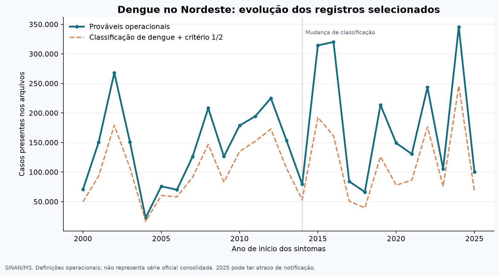
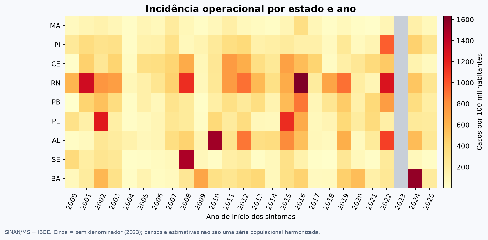
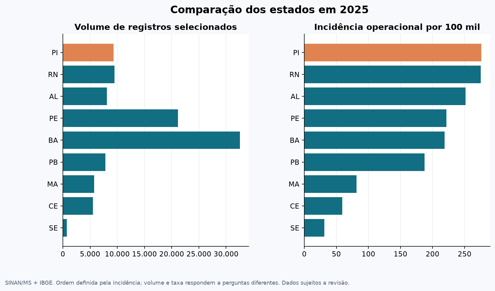
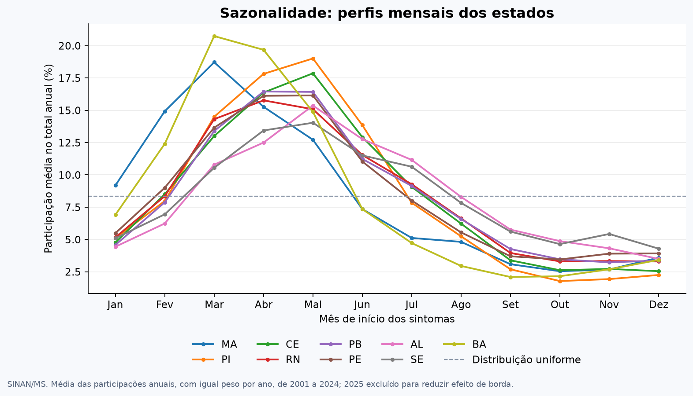
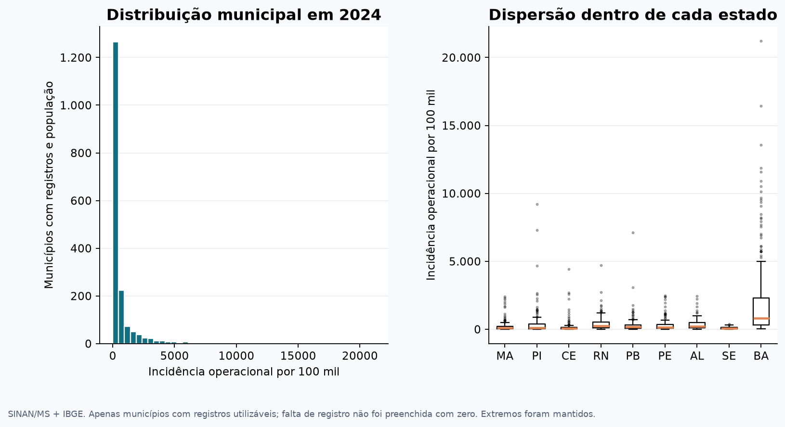
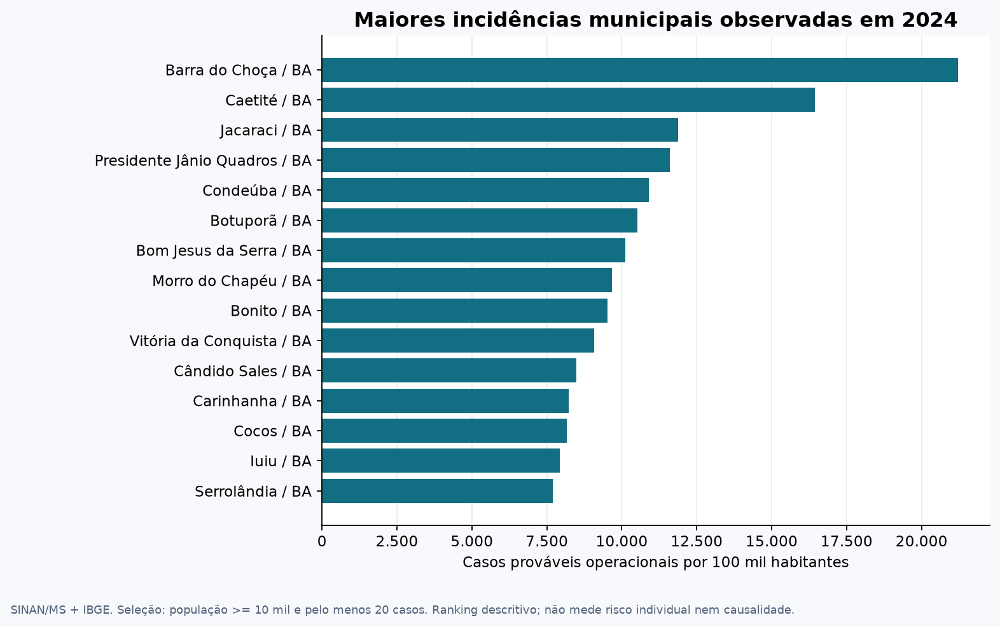
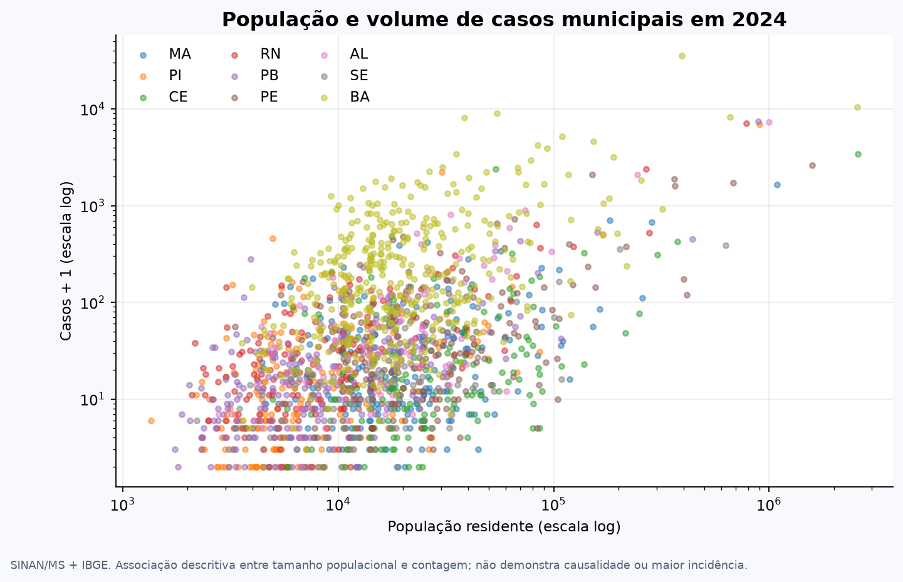
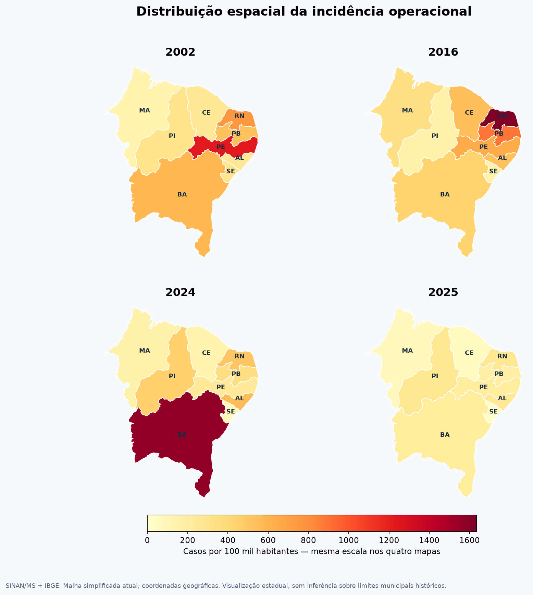
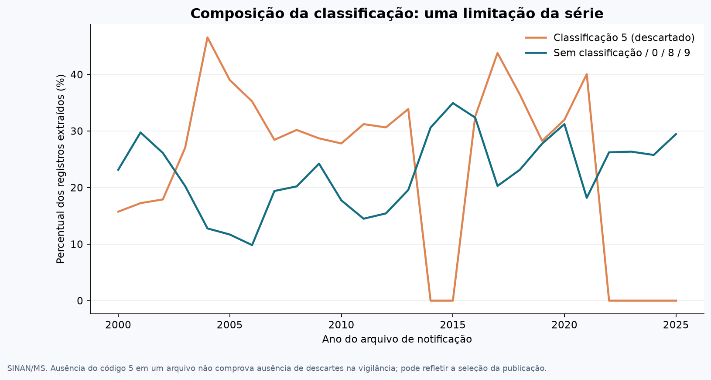

# Dengue no Nordeste: resultados da limpeza e EDA (2000–2025)

Etapa 2 do projeto IMD1151. Gerado em 2026-10-29T00:30:53-03:00. O estudo descreve casos prováveis operacionais disponíveis no SINAN, com denominadores do IBGE. As conclusões são exploratórias e dependem das limitações de cobertura e classificação.

## Limpeza e seleção

Dos 5.475.862 registros de entrada, 4.174.601 passam pela seleção ampla e 2.807.094 pelo cenário estrito. A diferença de 32,8% entre os cenários evidencia a dependência da definição de caso. Foram mantidos 45.621 registros selecionados com atraso de notificação superior a 60 dias, sinalizados para revisão.

A consulta complementar leu 470.451 registros nacionais de 2026, dos quais 122.911 de residentes no Nordeste. Encontrou 0 registros adicionais com sintomas até 2025. A população e a referência temporal do estudo não foram ampliadas para 2026.

## Primeiras respostas

### Evolução temporal

O maior volume no recorte selecionado aparece em 2024: 345.731 casos prováveis operacionais. No cenário estrito, o pico também deve ser verificado separadamente: 2024, com 246.034 registros. Esses picos descrevem os arquivos publicados e os filtros do projeto, sem demonstrar uma tendência causal ou uma série oficial consolidada.

### Diferenças entre estados

Em 2025, PI apresenta a maior incidência operacional entre os nove estados: 275,9 por 100 mil habitantes. O gráfico de volumes e taxas mostra por que o maior número absoluto de casos não determina a maior incidência.

### Sazonalidade

Na média das participações anuais de 2001 a 2024, 75,8% dos registros selecionados ocorrem de janeiro a junho. O mês de maior participação regional é 04. Os perfis estaduais diferem; esse padrão não foi submetido a teste de significância e não demonstra efeito causal de chuva ou temperatura.

### Valores atípicos

Foram sinalizados 10 estados-ano acima do limite superior de Tukey no histórico da própria UF. Os outliers municipais comparam taxas dentro da mesma UF e ano. Todos foram mantidos; a classificação indica necessidade de investigação, não erro nem epidemia automaticamente.

### População e contagem

Em municípios observados com população disponível em 2024, a correlação de Spearman entre população e volume de casos é 0,445. Ela descreve associação entre tamanho e contagem; não foi calculado teste inferencial e não se conclui que municípios maiores tenham maior incidência.

## Comparação estadual em 2025

| UF | Prováveis operacionais | Cenário estrito | Incidência / 100 mil |
| --- | --- | --- | --- |
| PI | 9.338 | 7.224 | 275,9 |
| RN | 9.513 | 4.009 | 275,3 |
| AL | 8.106 | 7.475 | 251,7 |
| PE | 21.178 | 15.024 | 221,5 |
| BA | 32.514 | 16.852 | 218,6 |
| PB | 7.807 | 7.401 | 187,5 |
| MA | 5.719 | 3.893 | 81,5 |
| CE | 5.495 | 4.887 | 59,3 |
| SE | 719 | 681 | 31,3 |

## Maiores incidências municipais observadas em 2024

| Município | UF | Casos | População | Incidência / 100 mil |
| --- | --- | --- | --- | --- |
| Barra do Choça - BA | BA | 8.161 | 38.481 | 21.207,9 |
| Caetité - BA | BA | 8.968 | 54.572 | 16.433,3 |
| Jacaraci - BA | BA | 1.769 | 14.901 | 11.871,7 |
| Presidente Jânio Quadros - BA | BA | 1.506 | 12.986 | 11.597,1 |
| Condeúba - BA | BA | 1.917 | 17.571 | 10.910,0 |
| Botuporã - BA | BA | 1.201 | 11.411 | 10.524,9 |
| Bom Jesus da Serra - BA | BA | 1.015 | 10.028 | 10.121,7 |
| Morro do Chapéu - BA | BA | 3.406 | 35.224 | 9.669,5 |
| Bonito - BA | BA | 1.560 | 16.393 | 9.516,3 |
| Vitória da Conquista - BA | BA | 35.785 | 394.024 | 9.081,9 |

Seleção previamente definida: população de pelo menos 10 mil habitantes e no mínimo 20 casos. Não é ranking de risco individual.

## Fluxo das exclusões

| Motivo exclusivo | Registros |
| --- | --- |
| uf_invalida | 0 |
| notificacao_invalida_ou_fora_recorte | 1 |
| agravo_incompativel_ou_ausente | 13 |
| duplicidade_marcada | 6 |
| classificacao_desconhecida | 0 |
| descartado | 1.296.090 |
| chikungunya | 0 |
| sintomas_invalidos_ou_fora_recorte | 5.137 |
| sintomas_apos_notificacao | 14 |

## Visualizações

## Limitações

- A classificação 5 não aparece nos arquivos dos anos 2014, 2015, 2022, 2023, 2024, 2025. Não se interpreta essa ausência como inexistência de descartes na vigilância; a seleção da publicação pode afetar comparações temporais.
- A definição ampla inclui classificações inconclusivas, ignoradas ou ausentes. O cenário estrito permite avaliar parte dessa sensibilidade, sem ser padrão-ouro de diagnóstico.
- 2023 permanece sem denominador populacional e sem incidência. Não houve interpolação ou cópia automática de outro ano.
- As taxas municipais disponíveis descrevem municípios com registros utilizáveis e população. Municípios sem registro não foram transformados em zero; rankings e histogramas não representam todos os municípios.
- Censos, estimativas e alterações territoriais têm referências diferentes. As malhas estaduais dos mapas são simplificadas e atuais; não harmonizam retrospectivamente os municípios.
- Subnotificação, revisões, mudanças no sistema e duplicidades sem marcação identificável podem permanecer. Não foram ajustados modelos, testadas hipóteses ou estimadas relações causais.

## Fontes

- [SINAN/Dengue: dados e definição de casos prováveis](https://dadosabertos.saude.gov.br/dataset/arboviroses-dengue)
- [Dicionário SINAN Online, revisão 2015](https://portalsinan.saude.gov.br/images/documentos/Agravos/Dengue/DIC_DADOS_ONLINE.pdf)
- [Ficha SINAN NET, 2006](https://saude.es.gov.br/Media/sesa/LACEN/Fichas_SINAN/ficha_16_sinan_Dengue.pdf)
- [IBGE/SIDRA: população](https://sidra.ibge.gov.br/tabela/6579)
- [IBGE: malhas geográficas](https://servicodados.ibge.gov.br/api/docs/malhas?versao=3)

## Uso de IA e revisão do grupo

ChatGPT/Codex auxiliou na implementação, documentação, figuras e verificações automatizadas. O grupo deve realizar e registrar a revisão humana e as contribuições individuais antes da entrega final.
